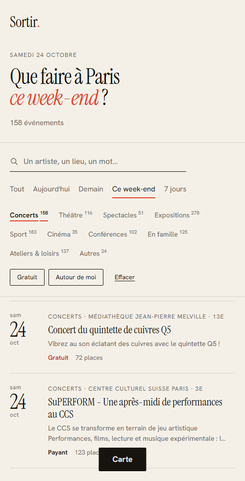

# Sortir

Find what to do in Paris: concerts, theatre, exhibitions, sport. Filter by date, category, price or distance, see it on a map, and **reserve a seat**.

Real data from [Paris Open Data](https://opendata.paris.fr/explore/dataset/que-faire-a-paris-/) (about 3,000 upcoming events).


|  |  |
|---|---|
|  |  |

## Run it

You need Docker. Nothing else.

```bash
docker compose up --build
```

Open **http://localhost:8080**. The first start also imports the events (about 30 seconds). The database admin UI is at http://localhost:8081.

## The interesting part: two people, one last seat

When two people reserve the last seat at the same instant, exactly one gets it. Never both.

Watch it happen. This creates a 10-seat event and fires 100 simultaneous requests at it:

```bash
cd backend
uv run python -m app.demo.race
```

```
answered in 0.98s: {'booked': 10, 'sold_out': 90}
database: seats_taken=10, booking rows=10 (capacity 10)
serialization conflicts retried by the server: 13
RESULT: no overbooking
```

How it works, in one line: **one atomic `UPDATE ... WHERE seats_taken < capacity`, inside a serializable CockroachDB transaction, with automatic retry.** The full explanation, with diagrams, is in [docs/ARCHITECTURE.md](docs/ARCHITECTURE.md#4-the-hard-part-two-people-one-last-seat).

## Stack

| Layer | Choice | Why (short) |
|---|---|---|
| Database | **CockroachDB** | Serializable transactions by default and PostgreSQL SQL. Cassandra was rejected: eventual consistency makes correct booking harder. |
| Backend | **FastAPI** (Python 3.12, async) | Typed, fast to write, auto API docs at `/docs`. |
| Python tooling | **uv** | One fast tool for Python, venv and a lockfile. Reproducible installs. |
| Frontend | **React + Vite + TypeScript** | A SPA is enough here (no login, no SEO need). |
| Data fetching | TanStack Query | Caching and cancellation without hand-written effects. |
| Map | Leaflet + OpenStreetMap | Free, no API key. |
| Delivery | Docker Compose, GitHub Actions | One command to run. CI tests against a real CockroachDB. |

Every choice, and what it cost, is in [docs/DECISIONS.md](docs/DECISIONS.md).

## Develop

```bash
docker compose up -d cockroach          # the database only

cd backend
uv sync                                 # install exactly what uv.lock says
uv run uvicorn app.main:app --reload    # API on :8000, docs on /docs
uv run python -m app.ingest             # import events
uv run pytest                           # 27 tests, real database
uv run ruff check . && uv run ruff format --check .

cd frontend
npm install
npm run dev                             # :5173, proxies /api to :8000
npm run lint && npm run typecheck && npm test && npm run build
```

Windows note: psycopg's async mode needs a selector event loop. `--reload` provides one. Without it on Windows, use Docker or WSL. (Linux, macOS and Docker are unaffected.)

## Project layout

```
backend/app/
  events/      search: router, SQL repository, schemas
  bookings/    reservation: the concurrency-critical code
  ingest/      Paris Open Data client, normalisation (pure functions), upsert
  db.py        connection pool + transaction retry
  schema.sql   tables and the constraints that protect reservations
backend/tests/ 27 tests: normalisation, search, booking, concurrency
frontend/src/  api/, hooks/, components/, lib/ (pure, tested), styles/
docs/          ARCHITECTURE.md (system design), DECISIONS.md
.claude/skills project rules for AI-assisted work (see below)
```

## What is real, and what is not

- **Real:** events, dates, venues, prices, coordinates and images come from Paris Open Data.
- **Not real:** seat capacity. The open data has none, so each event gets a stable fake capacity (20 to 200). Reservations demonstrate correct concurrency, they are not real ticketing. There is no login: a reservation is identified by email only.

## Next steps

Authentication and email verification, cancelling a reservation, scheduled re-ingestion, a Playwright test of the booking flow, generated API types, keyset pagination, and sharding the seat counter for very hot events. See [architecture section 7](docs/ARCHITECTURE.md#7-how-this-scales-and-what-breaks-first).

## How I used AI

I built this with Claude Code, and I steered it with written rules rather than ad-hoc prompts. The `.claude/skills/` folder holds the project's standards (concurrency rules, backend and frontend conventions, design system, git and docs style) and `CLAUDE.md` holds the overview. That kept the output consistent and reviewable. I tested everything against the real database and the real API, and checked the UI in a browser. I can explain every decision above.
