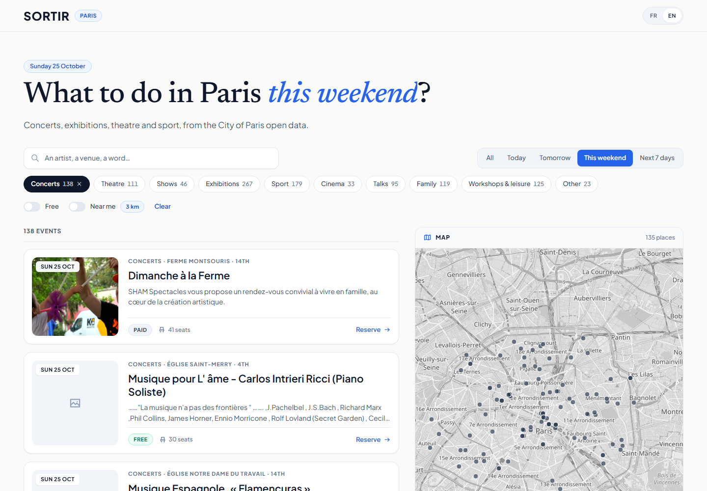

# Sortir

Trouvez quoi faire à Paris : concerts, théâtre, expositions, sport. Filtrez par date, catégorie, prix ou distance, voyez les lieux sur une carte et **réservez une place**.

Disponible en **français et en anglais** (sélecteur FR | EN en haut à droite).

Les données sont réelles, issues de [Paris Data](https://opendata.paris.fr/explore/dataset/que-faire-a-paris-/) (environ 3 000 événements à venir).

| Français | English |
|---|---|
|  |  |

| Détail et réservation | Mobile |
|---|---|
|  |  |

## Lancer le projet

Il faut seulement Docker.

```bash
docker compose up --build
```

Ouvrez **http://localhost:8080**. Au premier démarrage, les événements sont importés (environ 30 secondes). L'interface d'administration de la base est sur http://localhost:8081.

## Mettre en ligne (Vercel)

Le site et l'API se déploient sur Vercel, avec une base CockroachDB Cloud (essai gratuit). Guide pas à pas : [docs/DEPLOIEMENT.md](docs/DEPLOIEMENT.md).

## Le point technique central : deux personnes, une dernière place

Quand deux personnes réservent la dernière place au même instant, **une seule** l'obtient. Jamais les deux.

Pour le voir en direct, ce script crée un événement de 10 places et lui envoie 100 demandes simultanées :

```bash
cd backend
uv run python -m app.demo.race
```

L'événement de démonstration est supprimé à la fin : il n'apparaît jamais dans la vraie liste.

```
answered in 0.98s: {'booked': 10, 'sold_out': 90}
database: seats_taken=10, booking rows=10 (capacity 10)
serialization conflicts retried by the server: 13
RESULT: no overbooking
```

Le principe en une phrase : **une seule requête `UPDATE ... WHERE seats_taken < capacity`, atomique, dans une transaction sérialisable CockroachDB, avec nouvelle tentative automatique.** L'explication complète, avec schémas, est dans [docs/ARCHITECTURE.md](docs/ARCHITECTURE.md#4-le-point-difficile--deux-personnes-une-dernière-place).

## Technologies

| Couche | Choix | Pourquoi (en bref) |
|---|---|---|
| Base de données | **CockroachDB** | Transactions sérialisables par défaut et SQL compatible PostgreSQL. |
| Backend | **FastAPI** (Python 3.12, asynchrone) | Typé, rapide à écrire, documentation d'API automatique sur `/docs`. |
| Outil Python | **uv** | Un seul outil rapide pour Python, l'environnement et le fichier de verrouillage. Installations reproductibles. |
| Frontend | **React + Vite + TypeScript** | Une application monopage suffit ici (pas de compte, pas de besoin de référencement). |
| Données côté client | TanStack Query | Cache et annulation de requêtes sans effets écrits à la main. |
| Langues | Petite couche FR/EN typée (sans bibliothèque) | Une traduction manquante empêche la compilation. Voir les [décisions](docs/DECISIONS.md#11-traductions--français-et-anglais-avec-une-petite-couche-typée). |
| Design | CSS simple avec variables, Plus Jakarta Sans et Newsreader | Maquette créée avec Google Stitch, reconstruite en composants réutilisables. Voir les [décisions](docs/DECISIONS.md#12-design-visuel-issu-de-google-stitch-reconstruit-en-composants). |
| Carte | Leaflet + OpenStreetMap | Gratuit, sans clé d'API. |
| Pagination | Pages numérotées, page dans l'URL | Liens partageables, bouton retour fonctionnel. Voir les [décisions](docs/DECISIONS.md#14-pagination--pages-numérotées-pas-de-défilement-infini). |
| Livraison | Docker Compose, Vercel, GitHub Actions | Une commande pour lancer. La CI teste contre une vraie CockroachDB. |

Chaque choix, et ce qu'il coûte, est expliqué dans [docs/DECISIONS.md](docs/DECISIONS.md).

## Développer

```bash
docker compose up -d cockroach          # la base de données seule

cd backend
uv sync                                 # installe exactement ce que dit uv.lock
uv run uvicorn app.main:app --reload    # API sur :8000, documentation sur /docs
uv run python -m app.ingest             # importe les événements
uv run pytest                           # 27 tests, vraie base de données
uv run ruff check . && uv run ruff format --check .

cd frontend
npm install
npm run dev                             # :5173, redirige /api vers :8000
npm run lint && npm run typecheck && npm test && npm run build
```

Note Windows : le mode asynchrone de psycopg a besoin d'une boucle d'événements de type « selector ». `--reload` en fournit une. Sans `--reload` sous Windows, utilisez Docker ou WSL. (Linux, macOS et Docker ne sont pas concernés.)

## Organisation du dépôt

```
backend/app/
  events/      recherche : routeur, requêtes SQL, schémas
  bookings/    réservation : le code critique pour la concurrence
  ingest/      client Paris Data, normalisation (fonctions pures), insertion
  db.py        pool de connexions + nouvelle tentative des transactions
  schema.sql   tables et contraintes qui protègent les réservations
api/            point d'entrée Vercel (la même API FastAPI, en fonction serverless)
vercel.json     configuration du déploiement Vercel
backend/tests/ 27 tests : normalisation, recherche, réservation, concurrence
frontend/src/
  components/  ui/ (briques réutilisables), layout/, filters/, events/, drawer/, map/
  hooks/       données et état (URL, géolocalisation)
  i18n/        textes FR et EN
  lib/         fonctions pures et testées
  styles/      variables de design (tokens) et styles de base
docs/          ARCHITECTURE.md (conception du système), DECISIONS.md
.claude/skills règles du projet pour le travail assisté par IA (voir plus bas)
```

## Ce qui est réel, et ce qui ne l'est pas

- **Réel :** les événements, dates, lieux, prix, coordonnées et images viennent de Paris Data. Les titres et descriptions sont publiés en français : ils restent en français, même dans l'interface anglaise.
- **Fictif :** la capacité des salles. Les données ouvertes n'en contiennent pas, donc chaque événement reçoit une capacité fictive mais stable (20 à 200). Les réservations servent à démontrer une gestion correcte de la concurrence : ce n'est pas une vraie billetterie. Il n'y a pas de connexion : une réservation est identifiée par son e-mail seulement.

## Pistes d'amélioration

Authentification et vérification de l'e-mail, annulation d'une réservation, import planifié, test Playwright du parcours de réservation, types d'API générés, pagination par curseur, et compteur de places réparti pour les événements très demandés. Voir la [section 7 de l'architecture](docs/ARCHITECTURE.md#7-passage-à-léchelle-et-ce-qui-casse-en-premier).

## Comment j'ai utilisé l'IA

J'ai construit ce projet avec un assistant de programmation basé sur l'IA, et je l'ai guidé avec des règles écrites plutôt qu'avec des demandes au coup par coup. Le dossier `.claude/skills/` contient les standards du projet (concurrence, conventions backend et frontend, design, git et documentation) et `CLAUDE.md` en donne la vue d'ensemble. Cela a gardé le résultat cohérent et relisible. J'ai tout testé contre la vraie base de données et la vraie API, et vérifié l'interface dans un navigateur. Je peux expliquer chaque décision ci-dessus.
