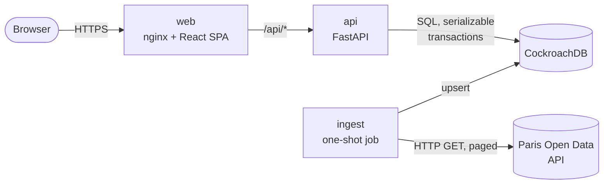
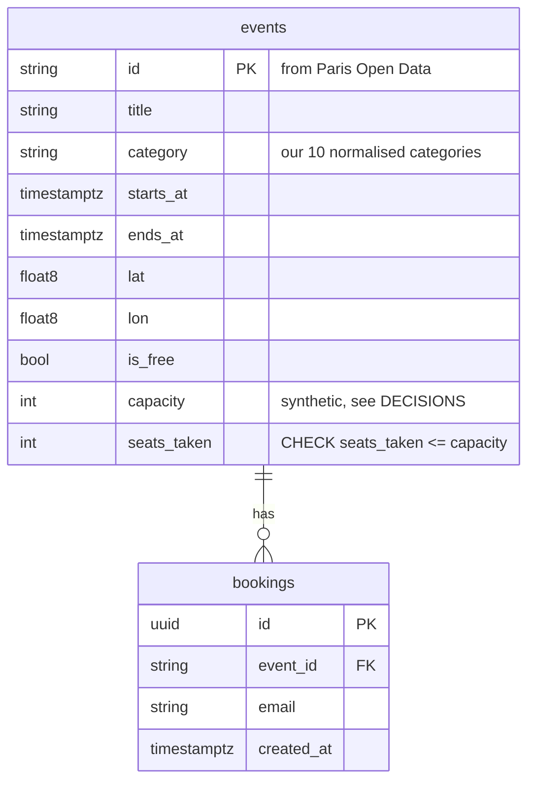
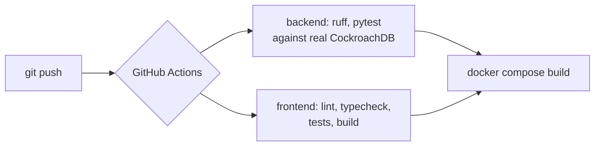

# System design

Read this in 5 minutes. It explains what the system is, how the parts talk, and above all **how it stays correct when many people act at the same time**.

## 1. What we are building

A web app to find events in Paris (concerts, theatre, exhibitions, sport...) and **reserve a seat**.

| Must do | Must stay true under load |
|---|---|
| Show real, fresh events from Paris Open Data | Never sell more seats than exist |
| Filter by date, category, price, text, distance | One person gets one seat per event |
| Show events on a map | A re-import of the data never changes reservations |
| Reserve a seat | Slow or failing upstream data never takes the site down |

**Scale we designed for:** about 3,000 upcoming events, read-heavy traffic, and short bursts of many people booking the same popular event. Section 7 explains what changes beyond that.

## 2. The big picture



| Part | Job | Why it is separate |
|---|---|---|
| **web** | Serves the static React app. Forwards `/api` to the API. | Static files are cheap and cacheable. The browser sees one origin, so no CORS. |
| **api** | Search, event details, reservations. Holds no state. | Stateless means you can run 1 or 10 copies behind a load balancer. |
| **ingest** | Copies events from Paris Open Data into our DB. Runs, then exits. | If the upstream API is slow or down, users still browse our copy. Ingestion failures never hurt requests. |
| **CockroachDB** | The only place state lives. | See section 4. |

**Why copy the data instead of calling Paris Open Data on each search?** Three reasons. Our own database lets us filter by distance, category and price, which the upstream API cannot do together. Our pages stay fast and keep working if upstream is down. And we need our own rows anyway to attach seats and bookings.

## 3. Data model



Two constraints carry the safety guarantees. They live **in the database**, so they hold even if application code has a bug:

- `CHECK (seats_taken >= 0 AND seats_taken <= capacity)` on `events`
- `UNIQUE (event_id, email)` on `bookings`

Indexes: `(starts_at)` and `(category, starts_at)` serve the common "what's on, soonest first" queries.

## 4. The hard part: two people, one last seat

### The bug we must prevent

Naive code reads, checks, then writes:

```
A: read seats_left → 1          B: read seats_left → 1
A: 1 > 0, ok, write 0           B: 1 > 0, ok, write 0      ← both booked. Overbooked.
```

The gap between "read" and "write" is the problem. Both requests saw the old truth.

### Our design: three layers

| Layer | What it does | What it protects against |
|---|---|---|
| **1. One atomic statement** | `UPDATE events SET seats_taken = seats_taken + 1 WHERE id = $1 AND seats_taken < capacity` | The check and the write are a single operation. There is no gap. 0 rows updated means sold out. |
| **2. Serializable transactions** | CockroachDB runs every transaction as if one at a time. If two truly conflict, it aborts one with error `40001`. | Subtle anomalies a single statement cannot catch, such as the booking row and the counter disagreeing. |
| **3. Automatic retry** | `db.run_transaction` catches `40001`, waits a random short time (exponential backoff with jitter), and re-runs the whole transaction. | Turns the DB's "please retry" into a transparent success. The user never sees it. |

Plus two safety nets: the `CHECK` constraint (layer 0, cannot be bypassed) and the `UNIQUE` constraint (double-click safety).

### What happens when A and B click at the same instant (last seat)

```mermaid
sequenceDiagram
    participant A as Request A
    participant B as Request B
    participant DB as CockroachDB
    A->>DB: BEGIN; INSERT booking (A)
    B->>DB: BEGIN; INSERT booking (B)
    Note over DB: different rows, no conflict
    A->>DB: UPDATE events ... WHERE seats_taken < capacity
    DB-->>A: 1 row (seat taken)
    B->>DB: UPDATE events ... WHERE seats_taken < capacity
    Note over DB: B waits for A's lock
    A->>DB: COMMIT
    DB-->>A: ok → 201 Created
    DB-->>B: re-checks: seats_taken = capacity → 0 rows
    B->>DB: ROLLBACK (booking B undone)
    DB-->>B: → 409 sold_out
```

If the database detects the conflict later instead, it aborts B with `40001`. Our retry layer re-runs B, which then finds 0 rows and answers `sold_out`. Both paths end the same way: **exactly one winner, the loser is rolled back completely**.

### Why the booking `INSERT` comes first

If the same person double-clicks, the second `INSERT` hits the `UNIQUE` constraint immediately and stops. It never touches the busy `events` row. Duplicates cost almost nothing and do not add contention for real buyers.

### Proof, not promises

`backend/tests/test_booking_concurrency.py` runs against a real CockroachDB:

| Scenario | Result asserted |
|---|---|
| 50 different people, 10 seats, all at once | exactly 10 `201`, 40 `409 sold_out`, `seats_taken = 10`, 10 rows |
| 1 person, 20 simultaneous requests | exactly 1 `201`, 19 `409 already_booked`, 1 seat used |
| Re-import runs while people book | seat counters unchanged |

Live demo against the running stack: `uv run python -m app.demo.race` fires 100 simultaneous requests at a 10-seat event. On my laptop (single node) it answered in about 1 second with 10 booked, 90 sold out and the database in agreement. The server transparently retried 13 to 21 conflicting transactions in each run. `GET /api/health` exposes `tx_retries`, so you can watch contention happen.

### Alternatives we rejected

| Option | Why not |
|---|---|
| `SELECT ... FOR UPDATE` then `UPDATE` | Works, but holds a lock across two round trips and is easy to get wrong. One conditional `UPDATE` is simpler and shorter. |
| Optimistic `version` column | Same retry need, plus extra column and more code, with no gain here. |
| Redis lock / Python `asyncio.Lock` | A lock in memory breaks as soon as there are two API copies. The database is the only shared truth, so the guarantee must live there. |
| Message queue, one worker per event | Correct and scales further, but adds infrastructure and delays the answer. Worth it only at much larger scale (section 7). |
| Cassandra | Eventually consistent by default. Safe counters and "only if" updates need lightweight transactions, which are slow and per-partition. See DECISIONS.md. |

## 5. Request flows

**Search** (`GET /api/events?category=concert&date_from=...&lat=..&lon=..`)

1. Router validates parameters and builds an `EventFilters` object.
2. Repository builds one parameterised SQL query. `count(*) OVER ()` returns the total in the same round trip.
3. Ordering: short events first, then those starting inside the window, then soonest. Year-long programmes sink to the bottom instead of burying concerts.
4. Distance uses the haversine formula in SQL, only when a location is given.

**Ingestion** (`python -m app.ingest`)

1. Ask Paris Open Data for events overlapping the next 90 days, 100 per page.
2. Normalise each record (pure functions, unit tested): HTML to plain text, 35 free-form tags to 10 categories, zip code to arrondissement, a stable synthetic capacity.
3. Upsert page by page. The `ON CONFLICT DO UPDATE` list **omits `capacity` and `seats_taken`**, so a re-import can never reset reservations.

## 6. Failure modes

| What breaks | What the user sees | Why |
|---|---|---|
| Paris Open Data is down | Nothing. Browsing and booking work. | We serve our own copy. Only freshness suffers. |
| Ingest crashes halfway | Slightly stale data. | Each page is its own transaction. Upserts are idempotent: just run it again. |
| Two people book the last seat | One succeeds, one gets a clear "sold out". | Section 4. |
| Heavy contention exhausts 10 retries | `503 busy` with `Retry-After: 1`. | An honest, retryable answer instead of a hang or a wrong result. |
| Database node is lost | Brief errors, then recovery (multi-node). | CockroachDB replicates with consensus. The demo runs one node for simplicity. |
| The frontend hits a failed request | An error message with a retry button. | Every view has loading, empty and error states. |
| A user submits hostile input | Rejected or inert. | Parameterised SQL only. LIKE wildcards escaped. Event HTML stripped at ingestion, never rendered. |

## 7. How this scales (and what breaks first)

Honest list. None of this is built, and I have not benchmarked beyond the demo above.

| Pressure | What breaks first | The fix |
|---|---|---|
| More readers | API CPU, then DB reads | Run more `api` copies (stateless). Cache `/api/categories` and common searches for a few seconds. Add a CDN for the static site. |
| One very popular event (a "hot row") | Every booking for it serialises on one row, so retries climb | Shard the counter into N rows and sum them. Or put bookings for that event through a queue. |
| Text search quality | `ILIKE` is not accent-insensitive and has no ranking | Trigram index first. Full-text search or OpenSearch if it matters. |
| Deep pagination | `OFFSET` gets slower on later pages | Keyset pagination on `(starts_at, id)`. |
| Data freshness | Manual ingest | Run `ingest` on a schedule (cron, or a CI job). Delete events that vanish upstream. |
| Single DB node | Availability | Run a 3-node CockroachDB cluster. Same SQL, no code change. |
| Abuse | Booking spam, scraping | Rate limiting at nginx or an API gateway, email verification, CAPTCHA. |

## 8. Security notes

- All SQL is parameterised. Dynamic filters assemble fixed SQL fragments, never user text.
- Third-party HTML is converted to plain text at ingestion, so there is nothing to inject at render time.
- No authentication: a reservation is identified by email only. Anyone can book for any email. Fine for a demo, not for production (section 7: email verification).
- The container runs as a non-root user. The database runs in insecure mode locally. Production needs TLS and credentials.
- Dependencies are locked (`uv.lock`, `package-lock.json`) and CI builds from the lockfiles.

## 9. Observability

- `GET /api/health` checks DB connectivity and reports `tx_retries`, the number of retried transactions since start. A rising number means contention.
- Structured access logs from uvicorn. CockroachDB's admin UI (http://localhost:8081) shows statement latency and contention events.
- Next: request IDs, Prometheus metrics (`/metrics`), tracing.

## 10. Deployment and CI



`docker compose up --build` is the whole deployment story for the demo: four containers, started in dependency order using health checks (DB healthy, then API healthy, then ingest and web). The frontend image is multi-stage, so the final image holds nginx and static files only.
