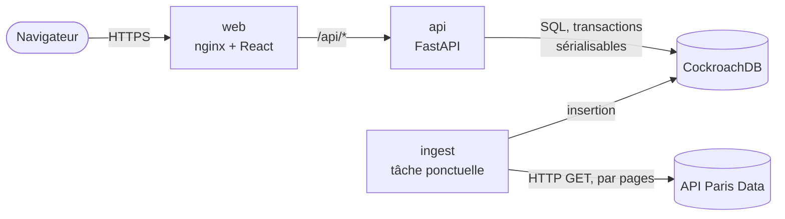
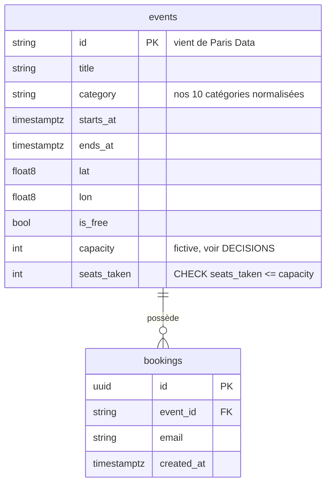
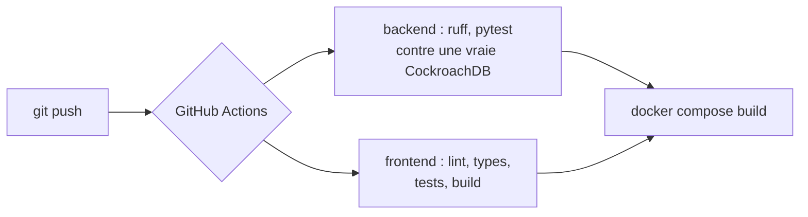

# Conception du système

À lire en 5 minutes. Ce document explique ce qu'est le système, comment ses parties communiquent et surtout **comment il reste correct quand beaucoup de personnes agissent en même temps**.

## 1. Ce que nous construisons

Une application web pour trouver des événements à Paris (concerts, théâtre, expositions, sport...) et **réserver une place**.

| Ce qu'elle doit faire | Ce qui doit rester vrai sous charge |
|---|---|
| Afficher de vrais événements récents de Paris Data | Ne jamais vendre plus de places qu'il n'y en a |
| Filtrer par date, catégorie, prix, texte, distance | Une personne = une place par événement |
| Montrer les événements sur une carte | Un nouvel import des données ne modifie jamais les réservations |
| Réserver une place | Une source de données lente ou en panne ne fait pas tomber le site |

**Échelle prévue :** environ 3 000 événements à venir, un trafic surtout en lecture, et de courtes rafales de personnes qui réservent le même événement populaire. La section 7 explique ce qui change au-delà.

## 2. Vue d'ensemble



| Partie | Rôle | Pourquoi elle est séparée |
|---|---|---|
| **web** | Sert l'application React (fichiers statiques). Transmet `/api` à l'API. | Les fichiers statiques sont peu coûteux et faciles à mettre en cache. Le navigateur ne voit qu'une origine : pas de CORS. |
| **api** | Recherche, détail d'un événement, réservations. Ne garde aucun état. | Sans état, on peut lancer 1 ou 10 copies derrière un répartiteur de charge. |
| **ingest** | Copie les événements de Paris Data dans notre base. S'exécute puis s'arrête. | Si l'API de Paris Data est lente ou en panne, les utilisateurs parcourent quand même notre copie. Un import raté n'affecte jamais les requêtes. |
| **CockroachDB** | Le seul endroit où vit l'état. | Voir la section 4. |

**Pourquoi copier les données plutôt qu'appeler Paris Data à chaque recherche ?** Trois raisons. Notre propre base permet de filtrer par distance, catégorie et prix ensemble, ce que l'API source ne sait pas faire. Nos pages restent rapides et fonctionnent même si la source est en panne. Et il nous faut de toute façon nos propres lignes pour y rattacher les places et les réservations.

## 3. Modèle de données



Deux contraintes portent les garanties de sécurité. Elles vivent **dans la base de données**, donc elles tiennent même si le code applicatif contient un bug :

- `CHECK (seats_taken >= 0 AND seats_taken <= capacity)` sur `events`
- `UNIQUE (event_id, email)` sur `bookings`

Index : `(starts_at)` et `(category, starts_at)` servent les requêtes courantes « que se passe-t-il bientôt ».

## 4. Le point difficile : deux personnes, une dernière place

### Le bug à empêcher

Un code naïf lit, vérifie, puis écrit :

```
A : lit seats_left → 1          B : lit seats_left → 1
A : 1 > 0, ok, écrit 0          B : 1 > 0, ok, écrit 0      ← les deux ont réservé. Surréservation.
```

Le problème est l'écart entre « lire » et « écrire ». Les deux requêtes ont vu l'ancienne vérité.

### Notre solution : trois couches

| Couche | Ce qu'elle fait | Ce qu'elle empêche |
|---|---|---|
| **1. Une instruction atomique** | `UPDATE events SET seats_taken = seats_taken + 1 WHERE id = $1 AND seats_taken < capacity` | La vérification et l'écriture ne font qu'une seule opération. Il n'y a plus d'écart. 0 ligne modifiée = complet. |
| **2. Transactions sérialisables** | CockroachDB exécute chaque transaction comme si elles passaient l'une après l'autre. Si deux transactions sont réellement en conflit, il en annule une avec l'erreur `40001`. | Les anomalies subtiles qu'une seule instruction ne voit pas, par exemple la ligne de réservation et le compteur en désaccord. |
| **3. Nouvelle tentative automatique** | `db.run_transaction` attrape `40001`, attend un court délai aléatoire (attente exponentielle avec « jitter »), puis relance toute la transaction. | Transforme le « réessayez » de la base en succès transparent. L'utilisateur ne le voit jamais. |

Auxquelles s'ajoutent deux filets de sécurité : la contrainte `CHECK` (impossible à contourner) et la contrainte `UNIQUE` (protection contre le double-clic).

### Que se passe-t-il quand A et B cliquent au même instant (dernière place)

```mermaid
sequenceDiagram
    participant A as Requête A
    participant B as Requête B
    participant DB as CockroachDB
    A->>DB: BEGIN; INSERT réservation (A)
    B->>DB: BEGIN; INSERT réservation (B)
    Note over DB: lignes différentes, pas de conflit
    A->>DB: UPDATE events ... WHERE seats_taken < capacity
    DB-->>A: 1 ligne (place prise)
    B->>DB: UPDATE events ... WHERE seats_taken < capacity
    Note over DB: B attend le verrou de A
    A->>DB: COMMIT
    DB-->>A: ok → 201 Created
    DB-->>B: revérifie : seats_taken = capacity → 0 ligne
    B->>DB: ROLLBACK (la réservation de B est annulée)
    DB-->>B: → 409 sold_out
```

Si la base détecte le conflit plus tard, elle annule B avec `40001`. Notre couche de nouvelle tentative relance B, qui trouve alors 0 ligne et répond `sold_out`. Les deux chemins finissent pareil : **un seul gagnant, le perdant est entièrement annulé**.

### Pourquoi l'`INSERT` de la réservation passe en premier

Si la même personne double-clique, le second `INSERT` heurte tout de suite la contrainte `UNIQUE` et s'arrête. Il ne touche jamais la ligne `events`, très sollicitée. Les doublons coûtent presque rien et n'ajoutent pas de contention pour les vrais acheteurs.

### Des preuves, pas des promesses

`backend/tests/test_booking_concurrency.py` s'exécute contre une vraie CockroachDB :

| Scénario | Résultat vérifié |
|---|---|
| 50 personnes différentes, 10 places, toutes en même temps | exactement 10 `201`, 40 `409 sold_out`, `seats_taken = 10`, 10 lignes |
| 1 personne, 20 requêtes simultanées | exactement 1 `201`, 19 `409 already_booked`, 1 place utilisée |
| Un nouvel import tourne pendant que des gens réservent | compteurs de places inchangés |

Démonstration en direct sur la pile qui tourne : `uv run python -m app.demo.race` envoie 100 requêtes simultanées à un événement de 10 places. Sur mon ordinateur (un seul nœud), la réponse arrive en environ 1 seconde : 10 réservées, 90 complètes, et la base est d'accord. Le serveur a relancé de façon transparente 13 à 21 transactions en conflit à chaque exécution. `GET /api/health` expose `tx_retries`, ce qui permet de voir la contention en action.

### Alternatives écartées

| Option | Pourquoi pas |
|---|---|
| `SELECT ... FOR UPDATE` puis `UPDATE` | Fonctionne, mais garde un verrou sur deux allers-retours et se trompe facilement. Un seul `UPDATE` conditionnel est plus simple et plus court. |
| Colonne `version` (verrouillage optimiste) | Même besoin de nouvelle tentative, plus une colonne et plus de code, sans gain ici. |
| Verrou Redis / `asyncio.Lock` Python | Un verrou en mémoire casse dès qu'il y a deux copies de l'API. La base est la seule vérité partagée : la garantie doit y vivre. |
| File de messages, un travailleur par événement | Correct et plus évolutif, mais ajoute de l'infrastructure et retarde la réponse. Utile seulement à bien plus grande échelle (section 7). |
| Cassandra | Cohérence éventuelle par défaut. Des compteurs sûrs et des mises à jour « seulement si » demandent des transactions légères, lentes et limitées à une partition. Voir DECISIONS.md. |

## 5. Parcours des requêtes

**Recherche** (`GET /api/events?category=concert&date_from=...&lat=..&lon=..`)

1. Le routeur valide les paramètres et construit un objet `EventFilters`.
2. Le dépôt construit une seule requête SQL paramétrée. `count(*) OVER ()` renvoie le total dans le même aller-retour.
3. Tri : les événements courts d'abord, puis ceux qui commencent dans la fenêtre, puis les plus proches dans le temps. Les programmations d'un an coulent au fond de la liste au lieu d'enterrer les concerts.
4. La distance utilise la formule de haversine en SQL, seulement quand une position est donnée.

**Import** (`python -m app.ingest`)

1. On demande à Paris Data les événements qui recouvrent les 90 prochains jours, 100 par page.
2. On normalise chaque enregistrement (fonctions pures, testées) : HTML en texte brut, 35 étiquettes libres en 10 catégories, code postal en arrondissement, capacité fictive mais stable.
3. Insertion page par page. La liste `ON CONFLICT DO UPDATE` **omet `capacity` et `seats_taken`** : un nouvel import ne peut donc jamais remettre les réservations à zéro.

## 6. Cas de panne

| Ce qui casse | Ce que voit l'utilisateur | Pourquoi |
|---|---|---|
| Paris Data est en panne | Rien. Parcourir et réserver fonctionnent. | Nous servons notre propre copie. Seule la fraîcheur en souffre. |
| L'import plante en cours de route | Données un peu anciennes. | Chaque page est sa propre transaction. Les insertions sont idempotentes : il suffit de relancer. |
| Deux personnes réservent la dernière place | L'une réussit, l'autre reçoit un « complet » clair. | Section 4. |
| Une forte contention épuise les 10 tentatives | `503 busy` avec `Retry-After: 1`. | Une réponse honnête et réessayable, plutôt qu'un blocage ou un résultat faux. |
| Un nœud de la base est perdu | Brèves erreurs, puis reprise (multi-nœuds). | CockroachDB réplique par consensus. La démo utilise un seul nœud par simplicité. |
| Le frontend reçoit une requête en échec | Un message d'erreur avec un bouton « Réessayer ». | Chaque vue a ses états de chargement, vide et erreur. |
| Un utilisateur envoie des données hostiles | Rejetées ou sans effet. | SQL paramétré uniquement. Jokers LIKE échappés. HTML des événements retiré à l'import, jamais affiché. |

## 7. Passage à l'échelle (et ce qui casse en premier)

Liste honnête. Rien de cela n'est construit, et je n'ai pas mesuré au-delà de la démo ci-dessus.

| Pression | Ce qui casse en premier | La solution |
|---|---|---|
| Plus de lecteurs | Le processeur de l'API, puis les lectures de la base | Lancer plus de copies d'`api` (sans état). Mettre en cache `/api/categories` et les recherches courantes quelques secondes. Ajouter un CDN pour le site statique. |
| Un événement très populaire (une « ligne chaude ») | Toutes les réservations passent l'une après l'autre sur une seule ligne, donc les nouvelles tentatives augmentent | Répartir le compteur sur N lignes et les additionner. Ou faire passer les réservations de cet événement par une file. |
| Qualité de la recherche texte | `ILIKE` ne gère pas les accents et ne classe pas les résultats | D'abord un index trigramme. Recherche plein texte ou OpenSearch si cela compte. |
| Pagination profonde | `OFFSET` ralentit sur les dernières pages | Pagination par curseur sur `(starts_at, id)`. |
| Fraîcheur des données | Import manuel | Lancer `ingest` à intervalle régulier (cron ou tâche CI). Supprimer les événements disparus de la source. |
| Un seul nœud de base | Disponibilité | Un cluster CockroachDB de 3 nœuds. Même SQL, aucun changement de code. |
| Abus | Spam de réservations, aspiration des données | Limitation de débit dans nginx ou une passerelle d'API, vérification de l'e-mail, CAPTCHA. |

## 8. Sécurité

- Tout le SQL est paramétré. Les filtres dynamiques assemblent des fragments SQL fixes, jamais du texte utilisateur.
- Le HTML tiers est converti en texte brut à l'import : il n'y a donc rien à injecter à l'affichage.
- Pas d'authentification : une réservation est identifiée par son e-mail seulement. N'importe qui peut réserver au nom de n'importe quel e-mail. Acceptable pour une démo, pas pour la production (section 7 : vérification de l'e-mail).
- Le conteneur tourne avec un utilisateur non administrateur. La base tourne en mode non sécurisé en local. La production exige TLS et des identifiants.
- Les dépendances sont verrouillées (`uv.lock`, `package-lock.json`) et la CI construit à partir de ces fichiers.

## 9. Observabilité

- `GET /api/health` vérifie la connexion à la base et indique `tx_retries`, le nombre de transactions relancées depuis le démarrage. Un nombre qui monte signale de la contention.
- Journaux d'accès d'uvicorn. L'interface d'administration de CockroachDB (http://localhost:8081) montre la latence des requêtes et les événements de contention.
- Étapes suivantes : identifiants de requête, métriques Prometheus (`/metrics`), traçage.

## 10. Déploiement et CI



`docker compose up --build` est toute l'histoire du déploiement pour la démo : quatre conteneurs, démarrés dans l'ordre des dépendances grâce aux contrôles de santé (base saine, puis API saine, puis ingest et web). L'image du frontend est en plusieurs étapes : l'image finale ne contient que nginx et les fichiers statiques.

## 11. Le frontend

Application monopage organisée en composants réutilisables :

```
components/
  ui/        Button, Chip, Segmented, Switch, Badge, StateMessage, Icon  (briques partagées)
  layout/    Header, Masthead (titre qui change avec la date), Footer
  filters/   SearchBox, WhenFilter, CategoryFilter, FilterBar
  events/    EventCard, EventList, Thumb
  drawer/    EventDrawer, SeatMeter, BookingForm
  map/       MapPanel (cadre) + MapView (Leaflet, chargé à la demande)
```

- **Les filtres et l'événement ouvert vivent dans l'URL** : les liens se partagent, le bouton « retour » fonctionne.
- **TanStack Query** gère les données du serveur : cache, annulation, nouvelle tentative.
- **`App.tsx` ne fait que relier les données aux composants.** La logique hors affichage est dans des hooks (`useUrlState`, `useLocate`, `queries`).
- **Deux langues** (FR et EN) via une petite couche typée : une clé manquante empêche la compilation.
- **Le design** vient de Google Stitch, reconstruit sur des variables CSS (`styles/tokens.css`) : aucune couleur ni police n'est écrite en dur dans un composant.
- **Mobile** : la liste et la carte se partagent l'écran. Un bouton flottant « Carte / Liste » (visible sous 900 px) permet de passer de l'une à l'autre.
